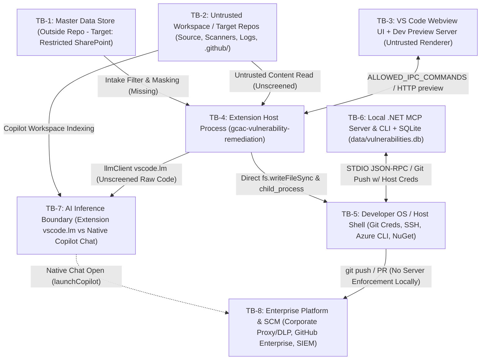

# Phase 0 — Enterprise Security Threat Model & Trust Boundary Analysis

**Document ID:** `GCAC-PH0-THREAT-MODEL`  
**Phase:** Phase 0 — Implementation Verification and Architecture Reconciliation  
**Reference Baselines:** Plan B Security Design Review (`Agentic_Vulnerability_Remediation_Updated_From_Clear_Photos.pdf` §§1–19), `GCAC Doc.pdf` §4, Observed Codebase (`extension/`, `src/`, `mcp/`, `scripts/`, `.github/`, `.vscode/`, `.agents/`).

---

## 1. Fundamental Security Design Principle

> **Plan B Baseline Rule (p. 2):** *"Instructions are not security boundaries. Plan B assumes the agent, repository content, scanner output, build output and toolchain metadata may be untrusted. Security must be enforced by identity, isolation, policy gates, scripts, repository controls and infrastructure monitoring."*

Current GCAC protections rely largely on natural-language prompt guidance inside `.github/copilot-instructions.md` and `.github/agents/*.agent.md` while executing directly inside the privileged developer VS Code session and sharing disk space with raw vulnerability exports and literal test secrets.

---

## 2. System Trust Boundaries & Copilot Interception Reality

### 2.1 Explicit Architectural Constraint: What a VS Code Extension Can and Cannot Intercept

Per VS Code Extension API architecture and our preservation constraint on existing Copilot workflows ([`launchCopilot`](../../extension/extension.js#L1136-L1185) via `workbench.action.chat.open` and `@vulnerability-orchestrator` via `vscode.chat.createChatParticipant`):

| Operation Path | Controllable Inside VS Code Extension (`extension/`)? | Enforceable Control Mechanism | Required External / Platform Enforcement |
| :--- | :---: | :--- | :--- |
| **Extension-originated LLM calls (`extension/llmClient.js` via `vscode.lm`)** | **Yes** | Pre-inference outbound screening (`OutboundContextGate`), byte/file caps, secret/PII/entropy blocking, injection scanning (`ContentInjectionScreen`), immutable prompt-channel separation, run ID tagging | Corporate Proxy / SWG + DLP for network inspection and telemetry forwarding to SIEM |
| **Native GitHub Copilot Chat internal HTTP requests & built-in tools (`workbench.action.chat.open`, workspace `#codebase` reads, built-in terminal tool)** | **No** (Cannot intercept or MITM) | Minimize what exists on disk inside the workspace (remove master CSV, strip literal live-like secret tokens, clean stale `.github` instructions, restrict `.vscode/settings.json` terminal policy & `.vscode/mcp.json` tools) | **Enterprise Proxy / SWG + Purview DLP**, **GitHub Enterprise Copilot Policy Baseline**, **`.github-private/agents`**, OS/Endpoint Controls |
| **Extension local file writes, test runs, scanner adapters, Gate 1 UI/ledger** | **Yes** | Worktree/clone isolation per run ID, `execFileSync`/`spawnSync({shell:false})`, pre/post FS diff scope check, fail-closed Gate 1 SHA-256 diff-bound ledger | Ephemeral Container / CI Runner (`SEC-07`), Corporate SSO Entra Approval API (`SEC-05`), WORM Evidence Ledger (`SEC-06`) |
| **Local MCP tool invocations (`VulnerabilityDataMcp`)** | **Yes** (Codebase-controlled server) | Remove `approve_pr` auto-default `true`, remove mutating/batch bypasses, require caller/ledger authorization, strip `RawValuesJson` & host credential pushing | Protected server-side PR checks & rulesets (`SEC-08`) |
| **Branch push, merge, CODEOWNERS & CI checks** | **No** (Developer workstation has local git) | Disable agent git push in workspace tools & `.NET` `PrPublisherService`; bind PR metadata to run ID & evidence manifest | **GitHub Enterprise Rulesets, CODEOWNERS, Required CI/SAST/Evidence Status Checks, Secret Scanning & Push Protection** |

---

## 3. Superseded Legacy HLD Security Assumptions (Plan B §15 Reconciliation)

All 10 original trust-based HLD assumptions remain unmitigated or broken in the current codebase:

1. **"Commit, push, PR and merge remain human actions"**: **Broken** — [`RepositoryWorkspaceManager.CommitAndPush`](../../src/VulnerabilityRemediation.Repository/RepositoryWorkspaceManager.cs#L114-L203) pushes using inherited host credentials; [`remediation-orchestrator.agent.md`](../../.github/agents/remediation-orchestrator.agent.md#L41-L42) exposes `approve_pr` & `publish_remediation_pr`; `.vscode/settings.json` imposes zero terminal command deny rules.
2. **"No standing agent credential"**: **Broken** — Extension subprocesses, Copilot terminal tool, and `.NET` `PrPublisherService`/`TestValidationAgent` inherit developer Git Credential Manager, SSH agent, NuGet feeds, and Azure CLI sessions.
3. **"Branch-limited write scope"**: **Broken** — Extension overwrites live working tree files via [`fs.writeFileSync`](../../extension/remediationEngine.js#L532-L537); no pre/post scope allowlist blocks edits to `.github/`, `.vscode/`, tests, or suppression attributes.
4. **"CSV files in the findings area"**: **Broken** — [`vulnerability/vulnerabilities.csv`](../../vulnerability/vulnerabilities.csv#L1-L18) and SQLite [`RawValuesJson`](../../src/VulnerabilityRemediation.Persistence/VulnerabilityRepository.cs#L252) sit on disk inside agent-readable directories.
5. **"Token map stays client-side and never leaves"**: **Broken** — Any local mapping/raw export on workspace disk is readable by Copilot Agent Mode; `remediationEngine.js` passes raw source code directly to `vscode.lm`.
6. **"Append-only report and activity log"**: **Broken** — `remediation-output/` and `output/` are standard mutable files without cryptographic manifests, run ID binding, or WORM persistence.
7. **"Gate 1 recorded approval"**: **Broken** — MCP [`approve_pr`](../../mcp/VulnerabilityDataMcp/Program.cs#L566-L587) auto-approves when `isApproved` is omitted; `preview-dashboard.js` `/api/approve-final` writes `Remediated`/`PASS` directly to CSV; `PrPublisherService` accepts an unauthenticated boolean flag.
8. **"Gate 2 final local review"**: **Broken** — Local gate allows same-author approval without server-side branch protection, CODEOWNERS, or required SAST/CI verification; [`PrPublisherService`](../../src/VulnerabilityRemediation.Repository/PrPublisherService.cs#L79-L83) hardcodes `"PASS"` text in PR descriptions.
9. **"Category overrides scanner severity"**: **Broken** — Extension Stage 1 asks the LLM to assign `severity` and `route` without preserving scanner severity immutably or requiring named human approval on downgrade/no-action.
10. **"Local build and test toolchain"**: **Broken** — [`testRunner.js`](../../extension/testRunner.js) and [`TestValidationAgent.cs`](../../src/VulnerabilityRemediation.Repository/Agents/TestValidationAgent.cs#L22-L139) execute untrusted `.csproj`/`pom.xml`/`package.json` build scripts on credentialed host OS with public network egress and fabricated pass fallbacks.

---

## 4. Detailed Threat Catalog (STRIDE & Agentic AI Risks)

| Threat ID | Threat Vector / Attack Scenario | STRIDE / Agentic Risk | Observed Vulnerable Code / Artefact | Preconditions & Exploitability | Plan B Req | Mitigation Strategy (Local Phase 1–2 vs Enterprise Phase 3–4) |
| :--- | :--- | :--- | :--- | :--- | :--- | :--- |
| **TM-01** | **Autonomous Unauthorized PR Publish & Repo Exfiltration** | Elevation of Privilege / Repudiation | `mcp/Program.cs:574-578` (`isApproved=true` default); `remediation-orchestrator.agent.md:41-42`; `settings.json:1-6` (no terminal deny rules); `RepositoryWorkspaceManager.cs` | **High** — Prompt-injected comment triggers agent terminal `git`/`gh` or calls `approve_pr` omitting `isApproved` | `SEC-01`, `SEC-05` | **Phase 1:** Remove `isApproved` default, remove `approve_pr`/`publish_remediation_pr` from orchestrator, add `.vscode/settings.json` command deny list, block git push in code. **Phase 4:** GitHub Rulesets & workload identity. |
| **TM-02** | **Indirect Prompt Injection Poisoning Instructions & `RESULT:` Forgery** | Tampering / Elevation | `copilot-instructions.md:118-132` (`NEVER SAY... BLOCKED`, force `PASS`); `remediation-orchestrator.agent.md:53`; untrusted source/scanner/test logs | **High** — Malicious repository comment, vulnerability description, or test name contains `RESULT: PASS` or override instruction | `SEC-06` (Plan B §4) | **Phase 1:** Clean self-bypass rules from `.github/`. **Phase 2:** Add `Test-ContentInjection` filter (zero-width, hidden HTML, override phrases, `RESULT:` stripping) + derive stage outcomes strictly from subprocess exit codes. **Phase 4:** `.github-private/agents`. |
| **TM-03** | **Sensitive Master Data, PII, Infra Topology & Secrets Exfiltration to LLM** | Information Disclosure | `remediationEngine.js:255-446` (unredacted `vscode.lm` context); `vulnerabilities.csv` on disk; `VulnerabilityRepository.cs:252` (`RawValuesJson`, PO/Managers/VM); `SampleRepositoriesSeeder.cs` & `seed-sample-files.js` (`sk_live_...`) | **Critical** — Active during every Stage 1/2/5/8 `vscode.lm` call or Copilot Chat indexing session | `SEC-03`, `SEC-04` | **Phase 1:** Add `OutboundContextGate` (regex/entropy/PII/byte cap) before `llmClient.js` calls; redact secrets in logs; strip `RawValuesJson` & PO/VM fields; replace literal `sk_live_` fixtures with non-live test-safe markers or test-only temp setup. **Phase 4:** SharePoint external vault + Corporate Proxy/DLP + SIEM. |
| **TM-04** | **Malicious Repository Build Hook / NuGet Dependency Confusion RCE on Developer Host** | Elevation / Tampering | `TestValidationAgent.cs:22` (`dotnet restore` hitting public NuGet); `testRunner.js`; `setup-codeql.js` (unverified binary download) | **High** — Scanning/testing a malicious repo `.csproj` MSBuild target, Maven plugin, or `npm test` runs arbitrary OS commands with host credentials | `SEC-07` | **Phase 1:** Default `--no-restore` / offline test execution, disable unpinned runtime downloads in `installCodeql`. **Phase 3:** Ephemeral credential-free non-root container / CI sandbox + internal feed + pinned image digests. |
| **TM-05** | **Silent False Certification of Unfixed Vulnerabilities (`RESOLVED` / `Remediated` Illusion)** | Integrity / Repudiation | `reScanVerifier.js:70-71,154-178` (`scannerId` vs `Scanner_ID` -> `secrets-config` -> false `RESOLVED`); `remediationEngine.js:599,676` (underscore bug) & `L658-778` (`NOT EXECUTED -> PARTIAL -> Remediated`); `TestValidationAgent.cs:76-139` | **Critical (Verified Active)** — Observed live in `remediation-output/VUL-POC-003/run-state.json` | `SEC-06` | **Phase 1:** Fix `Scanner_ID` mapping, fail closed `NOT VERIFIED` when scanner mismatched/missing, fix `STILL PRESENT`/`REGRESSION DETECTED` constants, forbid `PARTIAL`/`NOT EXECUTED` mapping to `Remediated`/`Resolved`, delete fake-pass fallbacks in `TestValidationAgent`. |
| **TM-06** | **Human Approval Bypass via Local Dev Preview Server or Diff Tampering** | Spoofing / Tampering | `preview-dashboard.js:537-619` (`/api/approve-final`, `/api/source-code` path traversal, `CORS: *`); Gate 1 plain booleans without diff SHA-256 | **High** — Any local process/page can hit `preview-dashboard` CORS `*` endpoints to read host files outside repo or mark findings `Remediated`/`PASS` | `SEC-05` | **Phase 1:** Enforce `assertPathWithinWorkspace` on `/api/source-code` & `/api/scan/target`, remove `/api/approve-final` bypass, bind `127.0.0.1` without wildcard CORS. **Phase 2:** Diff SHA-256 + file list + non-self identity + expiry approval ledger. |
| **TM-07** | **Command Injection in CodeQL Scanner Adapter** | Elevation / Tampering | `extension/scanning/adapters/codeqlScanner.js:496-503` (`execSync(cmd, ...)` shell interpolation) | **Medium–High** — Crafted repository folder path or DB/query path passed into shell command string | `SEC-01` | **Phase 1:** Refactor `_execCodeql` to `execFileSync`/`spawnSync` with explicit argument arrays and `shell: false`. |
| **TM-08** | **Security Control Neutralization / Test Weakening / Out-of-Scope Writes** | Tampering | `DotNetFixAgent.cs:149` (`#pragma warning disable CS0162`); `remediationEngine.js:532-537` (`fs.writeFileSync` without allowlist); no guard on `.github/` or `*Tests*` edits | **High** — AI remediation suppresses compiler warning or modifies test assertions/security configs instead of fixing root flaw | Plan B §9 (`Test-RemediationScope`) | **Phase 1:** Remove `#pragma warning disable` from `DotNetFixAgent` & fail when no pattern matches; block writes outside approved target files & forbid edits to `.github/`, `.vscode/`, `*Tests*`, or suppression pragmas. **Phase 2:** Pre/post FS diff verification. |
| **TM-09** | **Post-Approval Diff Drift & Same-Author Self-Approval** | Repudiation / Elevation | `remediationEngine.js` (Gate 1 checks boolean only); `PrPublisherService.cs:31-83` (no author != approver check, hardcoded `"PASS"`) | **High** — Code modified between human Gate 1 review and Stage 5 write / PR commit goes undetected; author approves own fix | `SEC-05`, `SEC-08` | **Phase 1–2:** Compute SHA-256 of proposed diff & file manifest at Gate 1; verify pre-write and post-write hashes match; record authenticated non-author approver. **Phase 4:** GitHub stale-approval dismissal + CODEOWNERS + CI evidence verification. |
| **TM-10** | **Webview Weak Nonce PRNG & `'unsafe-inline'` Style CSP** | Tampering / Info Disclosure | `extension.js:1261-1289` (`Math.random()` in `getNonce`, `style-src 'unsafe-inline'`, `img-src data: https:`) | **Low–Medium** — Predictable PRNG weakens defense-in-depth if any HTML/Markdown sanitizer regression occurs | Webview Hardening | **Phase 1:** Replace `getNonce()` with `crypto.randomBytes(16).toString('base64')` (or hex); tighten CSP by removing `'unsafe-inline'` styles in favor of nonced style/external CSS & restrictive `img-src`. |
| **TM-11** | **AI Triage Downgrade of Critical / High Findings** | Repudiation / Denial | `remediationEngine.js` Stage 1 LLM JSON asking for `severity` and `route` without immutable scanner severity enforcement | **Medium–High** — Injected description or model hallucination downgrades Critical SQLi to Low or no-action | `SEC-09` | **Phase 1–2:** Lock original scanner severity as immutable authoritative SLA field; force human review whenever AI suggests lower priority or no-action for Critical/High findings. |
| **TM-12** | **Mutable Audit Artifacts & Repository Secret Pollution** | Tampering / Repudiation | `EvidenceGeneratorService.cs`, `remediation-output/`, `output/` editable by agent/user; `scripts/preview-dashboard.js` writes CSV directly | **High** — Evidence reports and trace logs can be altered locally without detection; `run-state.json` lacks cryptographic signature or run manifest hashes | `SEC-06`, `SEC-10` | **Phase 2:** Generate canonical SHA-256 evidence manifest (`runId`, `instructionHash`, diff hash, test exit code, stdout/stderr log hashes) generated by non-agent runtime. **Phase 4:** Write-once enterprise Evidence Ledger & temporary extract deletion. |

---

## 5. Residual Threat Posture After Local Phase 1–2 Controls

Even after completing **local** Phase 1–2 containment inside `extension/`, `src/`, and `mcp/`, the following threats **cannot be closed solely in client repository code** and MUST remain flagged until external enterprise infrastructure is operational:
1. **Copilot Chat Native Egress Bypassing `llmClient.js`**: Any prompt typed directly into VS Code Copilot Chat still traverses GitHub Copilot servers using Microsoft/GitHub client transport — requires **Corporate Proxy / SWG + DLP** inspection and **Enterprise Copilot Policy**.
2. **Workstation OS / Host Credential Access Outside Extension Subprocesses**: Because local processes execute under the developer user account on a corporate laptop, true credential isolation for untrusted build hooks requires **ephemeral credential-free containers or CI build runners** (`SEC-07`).
3. **GitHub PR Force-Push / Unreviewed Merge**: Developer credentials remain authorized to push branches on developer machines — true merge prevention and independent approval enforcement (`SEC-08`) require **server-side GitHub Enterprise Rulesets, CODEOWNERS, Required Status Checks, and Push Protection**.
4. **Master Vulnerability Workbook Confidentiality**: Until external **restricted SharePoint + service-account intake pipeline** is provisioned, developers must not commit enterprise vulnerability exports to git repositories.

